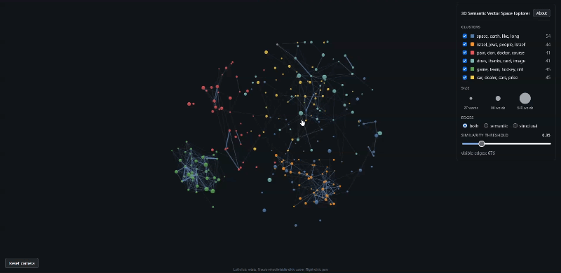

# 3D Semantic Vector Space Explorer

An interactive 3D map of document embeddings that makes the retrieval step of a RAG system visible: click a document and see which eight documents a nearest-neighbour retriever would hand to the LLM as context.

**[Live demo](NETLIFY_URL)** (desktop browser, no installation) · [Project report (PDF)](report/Final_Report.pdf) · [Technical documentation](docs/TECHNICAL.md)



Final project for Scientific and Large Data Visualization, University of Pisa (2026).

## The problem

In a RAG system, everything the LLM knows about a question comes from the retrieval step: embed the query, find the nearest chunks, pass them as context. That step decides answer quality, yet it happens in hundreds of dimensions that nobody can look at. When an answer is bad, the first question is "what did it actually retrieve, and why?"

## What it does

Each sphere is one document from the 20 Newsgroups corpus (270 posts from six categories), placed by the meaning of its text: 384-dimensional sentence embeddings (`all-MiniLM-L6-v2`) projected to 3D with UMAP.

- **Click a document to simulate a retrieval query.** Its 8 nearest neighbours by cosine similarity light up as the retrieved context, the rest of the corpus fades, and a side panel lists the retrieved texts with their scores.
- **Navigate semantically** by clicking a retrieved document to make it the next query.
- **Inspect the space:** topic clusters labelled with their top TF-IDF keywords, similarity edges with an adjustable threshold, filters by cluster and edge type.

Visual encoding: colour is the K-Means topic cluster, size is document length, blue edges are cosine similarity (brighter and thicker means more similar), gray edges connect documents of the same source category.

The retriever is the simplest one, cosine nearest neighbours over the same embeddings, with the clicked document acting as the query. It is a teaching and debugging view of that mechanism, not a plug-in for an existing RAG stack.

## What the visualisation showed about retrieval

These are observations that are easy to state and hard to see in numbers. They come from one small corpus (270 short Usenet posts) and one embedding model, so they illustrate behaviour rather than prove general results.

| Observation | Why it matters for RAG |
|---|---|
| **Similarity cut-offs are corpus-specific.** Over all 36,315 document pairs the median cosine was 0.025 and the 99th percentile 0.41. The cut-off of 0.6 I had planned would have left 16 edges. | A cut-off copied from another corpus or model can return almost nothing. Calibrate it on your own distribution (plain top-k retrieval is not affected). |
| **Vague queries retrieve scattered context.** The documents whose 8 neighbours all fall in other clusters are very short or generic ("Sigh.", "I have just a couple of questions about this technique."). | Short generic text carries little topical signal, so its neighbours are nearly arbitrary. Likely the same effect that makes vague questions retrieve poorly in production RAG; I did not test query rewriting. |
| **Retrieval follows meaning, not category.** 59 of 270 documents have at least 3 of their 8 neighbours in another cluster, often for good reasons: a graphics question about map projections retrieves from two clusters. | A metadata filter and semantic retrieval can disagree, so combining them needs care. |
| **Nearest in embedding space is not nearest on the map.** For one query (document 112) the eight nearest neighbours lay between 52 and 142 scene units away in the 3D projection, a spread of almost 3×. | Any 2D/3D map of embeddings is an approximation. A debugging view should show the true neighbours, not just proximity. |
| **A retrieval result is not a subgraph of a similarity graph.** Top-k is asymmetric: B can be in A's top 8 while A is not in B's top 10. For document 112, four of the eight neighbour pairs had no edge in the data. | Showing a retrieval correctly means storing the real k-NN result, so the tool keeps it as display-only links. |

## Engineering notes

- **Reproducible pipeline.** One command rebuilds everything from raw text in about 80 seconds. Stages are cached by a corpus hash, and two independent full rebuilds produced byte-identical output (SHA-256).
- **Data contract.** A versioned JSON schema with a validator. It was frozen before the UI work and changed once, deliberately (v1.1, after the retrieval-subgraph problem above).
- **One state object, one render function.** Every interaction goes through `applyState()`, so combinations such as querying while filtering stay consistent. 14 combination scenarios tested.
- **Problems found by measuring.** The graph library applied a global link opacity that silently multiplied per-edge transparency. On a hybrid-graphics laptop the browser ran on the integrated GPU: 33 to 36 FPS orbiting, against 100 to 105 on the dedicated GPU for the same scene. The final scene runs at 125+ FPS on a GTX 1650 Ti laptop.
- **Small user study.** 7 participants (5 in a perceptual test). Only 3 of 5 read sphere size as document length, so I added a size legend and an explicit line in the About overlay. The sample is small and not representative.
- **Works offline.** Static site, no build step, no CDN. The libraries are vendored as a tested pair (three.js 0.169.0 with 3d-force-graph 1.73.0), and the same 10-step scenario passed in Chrome, Firefox and Safari.

## Tech stack

- **ML / NLP:** sentence-transformers (`all-MiniLM-L6-v2`), UMAP, scikit-learn (K-Means, silhouette, TF-IDF), NumPy, pandas
- **Visualisation / frontend:** JavaScript (ES modules), Three.js, 3d-force-graph, D3.js, HTML/CSS
- **Engineering:** Python 3.11, Git, schema validation, deterministic builds

## Run it locally

The generated data file is committed, so the app runs without the pipeline:

```bash
cd web
python -m http.server 8000        # then open http://localhost:8000
```

Serve it over HTTP. Opening `index.html` as a file is blocked by the browser. To rebuild the data from raw text (downloads the corpus and about 91 MB of model weights on the first run):

```bash
python3.11 -m venv .venv && source .venv/bin/activate   # Windows: .\.venv\Scripts\Activate.ps1
pip install -r pipeline/requirements.txt
cd pipeline && python build_graph.py --recompute && python validate_json.py && python check_pii.py
```

Full setup, configuration and the list of limitations: [`docs/TECHNICAL.md`](docs/TECHNICAL.md).

## Limitations

- **Small, static corpus:** 270 posts from 6 of the 20 categories, one embedding model, one seed.
- **The query is a click** on an existing document. Free-text queries are not supported.
- **Desktop only**, designed for about 300 nodes.
- **Colour:** red, orange and green clusters are hard to tell apart under simulated deuteranopia and protanopia. Position and keyword labels are the backup channels.

## What I would build next

- **Free-text queries** with an in-browser embedding model (transformers.js), so you can type a question and watch what is retrieved.
- **Chunk-level retrieval** instead of whole documents, as in production RAG.
- **Side-by-side comparison of embedding models** on the same corpus.
- **Hybrid search view** (BM25 plus dense) to show where lexical and semantic retrieval disagree.

## Data

The documents come from the 20 Newsgroups corpus (K. Lang, 1995), loaded through scikit-learn. The loader strips headers, footers and quoted replies, and sender lines and e-mail addresses are redacted from the text shown in the app. The posts are from 1990s Usenet and may still contain names.

## Licence and credits

Released under the MIT License, see `LICENSE`. Vendored libraries keep their own licences (texts in `web/vendor/LICENSES.txt`): Three.js and 3d-force-graph (MIT), D3 (ISC). The embedding model `all-MiniLM-L6-v2` is Apache-2.0.

Marcin Czarnecki, M.Sc. Computer Science (AI), University of Pisa, www.linkedin.com/in/marcin-czarnecki-002488309
